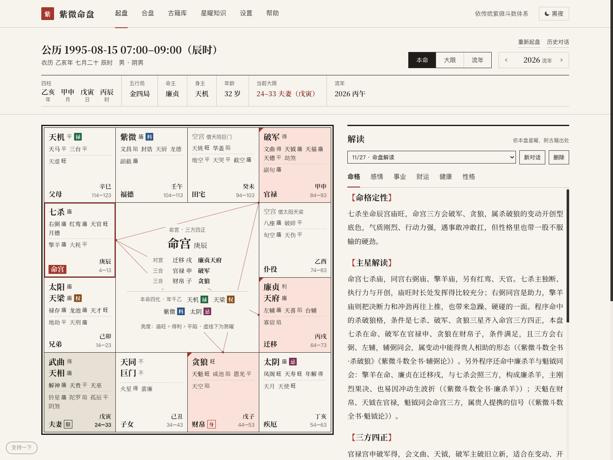
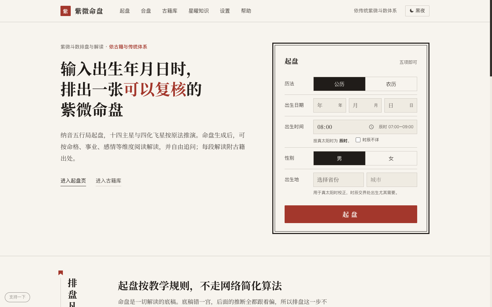
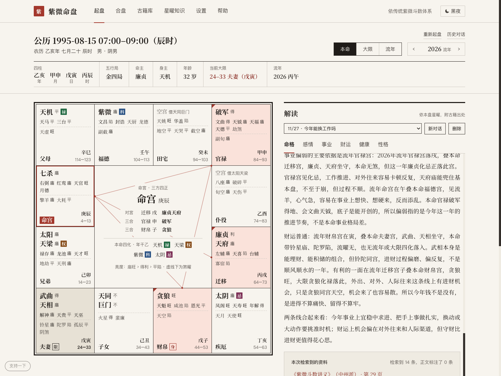
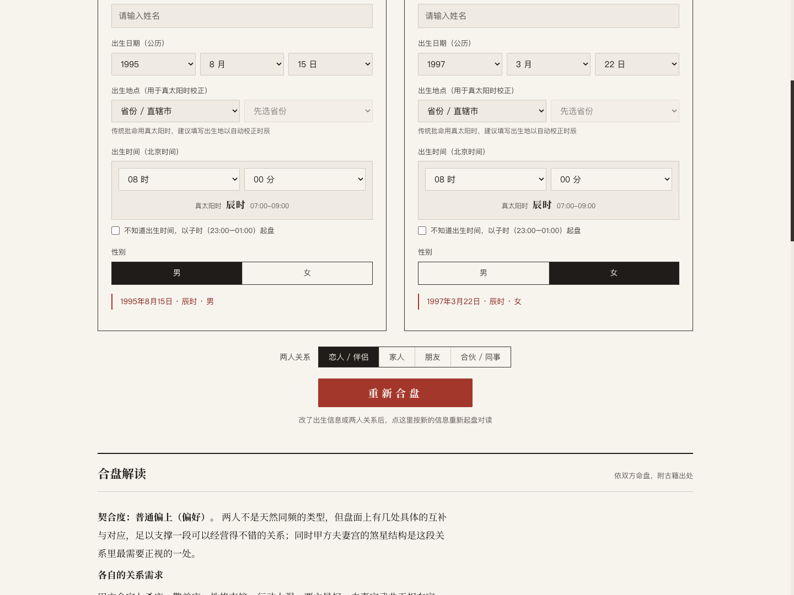
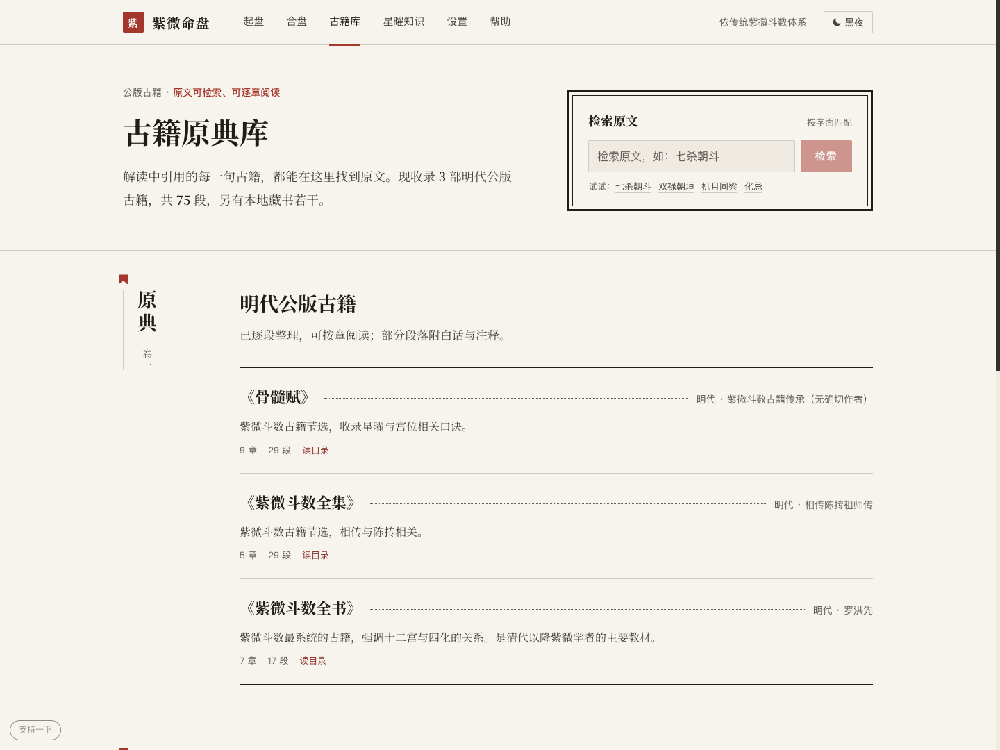

<div align="center">

# Ziwei Doushu · Desktop

Traditional Ziwei Doushu (紫微斗数) charting, compatibility readings, and classical texts, paired with **source-cited AI interpretations**.  
Desktop app for Mac & Windows, or run locally as a web app. All app features are free.

[](https://github.com/LMAYRY/ziwei-doushu-desktop/releases)
[](./LICENSE)
%20%7C%20Windows%20x64-lightgrey)

[中文](./README.md) · **English**

<br>



</div>

## Features

- **Three-Layer Charting**: Natal, decade (大限), and yearly (流年, 1800+) layers with true solar time calibration, the fourteen major stars, auxiliary stars, the four transformations (四化), brightness levels, and palace-stem self-transformations. Select any decade to sync with yearly overlays.
- **Compatibility (合盘)**: Side-by-side comparison of two charts across relationship modes (partner, family, friend, colleague/business), retrieving classical references for paired star combinations.
- **Source-Cited AI Readings**: Single-chart readings, compatibility readings, and multi-turn follow-ups (multiple conversations per chart).
  - **Retrieve Before Answering**: Runs local vector search + keyword search before generating each response; claims include book titles and page numbers you can inspect.
  - **Chart-Fact Verification**: Searches relevant palaces for wealth, marriage, career, and family questions, supplies twelve-palace flying transformations (宫干飞化) as facts, and automatically triggers a rewrite if the model contradicts chart branches or flying transformations.
  - **Bring Your Own Key (In-App Guide Included)**: Charting and classical texts work out of the box. AI readings use your own API key (DeepSeek, SiliconFlow, or any OpenAI-compatible endpoint). **The app includes a built-in step-by-step setup guide**, and keys stay encrypted locally (macOS Keychain / Windows DPAPI).
- **Libraries & Classics**:
  - **Classics**: Public-domain texts (*紫微斗数全集*, *紫微斗数全书*, *骨髓赋*) for chapter-by-chapter reading and full-text search.
  - **Personal Libraries**: Create multiple libraries, import your own PDFs (text extraction or OS-native OCR for scanned books), and toggle which libraries the AI searches.
- **Paper Typography & Local Privacy**: "Paper" aesthetic with light/dark themes; all charts, conversations, and libraries are stored locally on your machine.

## Screenshots

| Home · Quick Charting | AI Follow-Up · Book Citations |
| :---: | :---: |
|  |  |
| **Compatibility · Side-by-Side** | **Classics Library · Search** |
|  |  |

## Download & Install

Download installers from [Releases](https://github.com/LMAYRY/ziwei-doushu-desktop/releases):

- **Mac (Apple Silicon only, macOS 12+)**: `ziwei-x.y.z-mac-arm64.dmg`
  > Intel Macs are not supported by the desktop installer—please use **Run from Source** below.
- **Windows (10 / 11, 64-bit)**: `ziwei-x.y.z-win-x64-setup.exe`

Installers bundle an **encrypted built-in reference library** (27 books, search-only for AI retrieval, not readable directly).

> Note: The desktop builds are not code-signed. On macOS 15+, click **Done** on the warning dialog and allow the app under **System Settings › Privacy & Security** (or `Control`-click › **Open** on macOS 12–14; run `xattr -dr com.apple.quarantine /Applications/紫微斗数.app` if prompted as damaged). On Windows SmartScreen, click **More info › Run anyway**. Detailed walkthrough in Chinese: [install-guide.md](./docs/install-guide.md).

## Run from Source (Local Web App)

Requires **Node.js 20+**.

```bash
# Quick start on Mac / Linux
bash scripts/start-web.sh          # Dev mode: http://localhost:3000
bash scripts/start-web.sh --prod   # Production build & start
```

Or run manually on Windows / Mac / Linux:

```bash
npm install
npm run model:download          # Local embedding model (~24 MB)
npm run library:download        # Optional built-in library (~46 MB, encrypted, search only)
cp .env.example .env.local      # Windows: copy; add your AI key and keep ZIWEI_SELF_HOSTED=1
npm run dev                     # http://localhost:3000
```

- `ZIWEI_SELF_HOSTED=1` enables local library management and PDF imports under `library/`. **Do not enable it on a public deployment.**
- If `npm run library:download` is slow, download `ziwei-library-v1.tar.gz` from [Releases](https://github.com/LMAYRY/ziwei-doushu-desktop/releases) and run `ZIWEI_LIBRARY_URL=/path/to/ziwei-library-v1.tar.gz npm run library:download`.

## Build Desktop Apps & Development

```bash
npm run desktop:dist        # macOS (Apple Silicon) dmg
npm run desktop:dist:win    # Windows x64 installer (cross-buildable on macOS)
```

Artifacts are written to `dist-desktop/release/`. Run `npm run model:download` (and optionally `npm run library:download`) before packaging. If `node_modules/electron/dist` is missing due to blocked install scripts, run `node node_modules/electron/install.js`.

Verify code changes with:

```bash
npm run typecheck
npm test
```

## License & Acknowledgments

- Licensed under [MIT](./LICENSE).
- Charting engine, pattern knowledge base, and original UI come from [Renhuai123/ziwei-doushu](https://github.com/Renhuai123/ziwei-doushu) (MIT).
- Built with [iztro](https://github.com/SylarLong/iztro), [lunar-javascript](https://github.com/6tail/lunar-javascript), and [BAAI bge-small-zh-v1.5](https://huggingface.co/Xenova/bge-small-zh-v1.5) (MIT). Full third-party license notices are available on the app's **版权与许可** page (`lib/licenses.ts`).
- Reference books in the built-in library remain copyrighted by their respective authors and publishers and are not distributed with the source code.
- Readings reflect traditional literature and heuristics and do not constitute medical, financial, or legal advice.

Issues and feedback are welcome at [GitHub Issues](https://github.com/LMAYRY/ziwei-doushu-desktop/issues).
