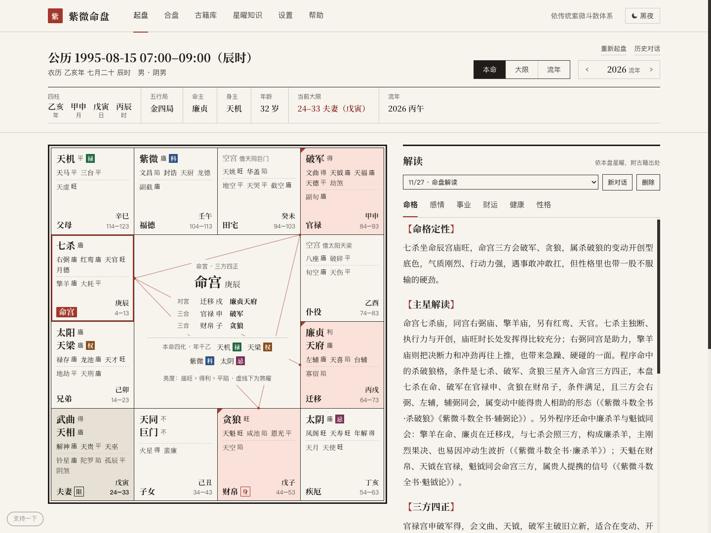
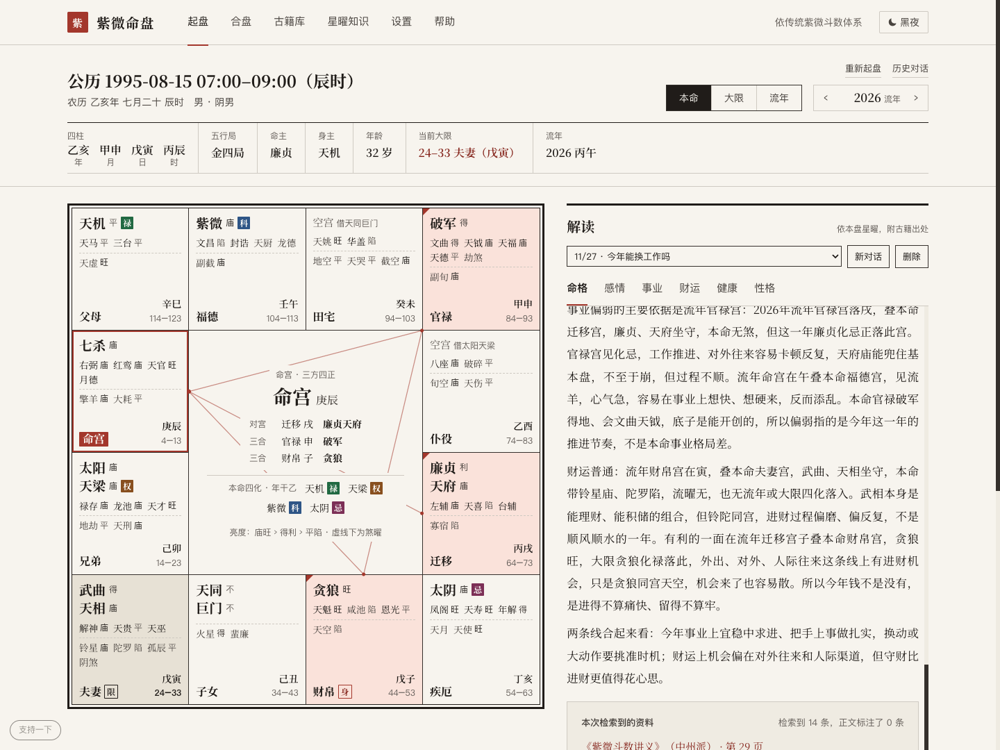
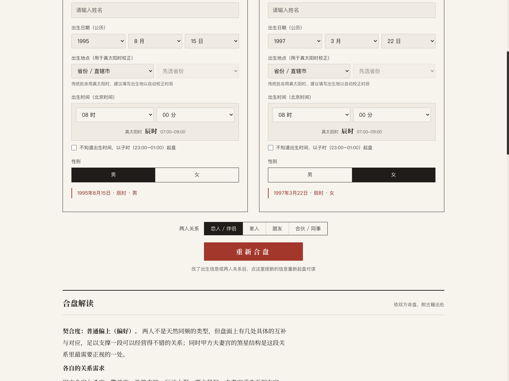

<div align="center">

# 紫微斗数 · 桌面版

排盘、合盘、古籍阅读，加上**会查书、附出处**的 AI 解读。  
Mac / Windows 桌面应用，也可在本机作为网页版运行，软件全部功能免费。

[](https://github.com/LMAYRY/ziwei-doushu-desktop/releases)
[](./LICENSE)
%20%7C%20Windows%20x64-lightgrey)

**中文** · [English](./README.en.md)

<br>



</div>

## 核心功能

- **三层排盘**：支持本命、大限、流年三层排盘与真太阳时校正，涵盖十四主星、辅星、四化、庙旺利陷及宫干自化；可任选大限并与流年联动（流年支持 1800 年以后）。
- **双人合盘**：两张命盘并排对照，支持恋人、家人、朋友、合伙等关系视角，按双方星曜组合检索书库辅助解读。
- **查书附出处的 AI 解读**：支持单盘解读、合盘解读与多轮追问（每个命盘可建多段独立对话）。
  - **先查书再回答**：解读前先按问题进行本机向量与关键词检索，回答中的判断附带书名和页码出处，支持点开核对原文。
  - **按盘面事实核对**：针对财富、姻缘、事业、六亲（父母、兄弟姐妹、子女）按对应宫位星曜组合查书，结合十二宫宫干飞化与流年叠宫做判断；若 AI 回答与命盘地支、飞化事实不符，程序会自动触发重写核对。
  - **自带 Key、界面内置教程**：排盘与古籍库开箱即用；使用 AI 解读需填入你自己的 API Key（支持 DeepSeek、硅基流动或任意 OpenAI 兼容接口）。**软件界面内提供详细的 API 注册与配置教程**，Key 仅加密保存在本机（Mac 钥匙串 / Windows DPAPI）。
- **书库与古籍阅读**：
  - **古籍库**：内置《紫微斗数全集》《紫微斗数全书》《骨髓赋》公版原文，支持逐章阅读与检索。
  - **个人书库**：支持自建多个书库并导入自己的 PDF（文字版直接读取，扫描版调用系统 OCR 识别），可自由勾选 AI 检索所用的书库范围。
- **「纸本」视觉与本地隐私**：「纸本」排版风格（宋体、米白纸色、朱红强调、刻本界栏式命盘），支持白天 / 黑夜双配色；命盘、对话记录与书库数据全部保存在本机，不上传云端。

## 界面预览

| 首页 · 快速起盘 | AI 追问 · 查书附出处 |
| :---: | :---: |
|  |  |
| **双人合盘 · 关系对照** | **古籍原典库 · 原文检索** |
|  |  |

## 下载与安装

前往 [Releases 页面](https://github.com/LMAYRY/ziwei-doushu-desktop/releases) 下载对应安装包：

- **Mac（仅 Apple 芯片，macOS 12 及以上）**：`ziwei-x.y.z-mac-arm64.dmg`
  > Intel 芯片 Mac 暂不提供桌面安装包，请参考下方「[从源码运行（本机网页版）](#从源码运行本机网页版)」在本机使用。
- **Windows（10 / 11，64 位）**：`ziwei-x.y.z-win-x64-setup.exe`

安装包附带**内置书库**（27 本参考书，正文已加密，仅供 AI 检索参考，不提供直接阅读）。

### 首次打开提示处理

由于应用未购买苹果 / 微软开发者签名，首次启动时系统会弹窗拦截，按以下方式放行一次即可：

- **Mac**：
  - **macOS 15 及以上**：先点「完成」，再前往「系统设置 › 隐私与安全性」点击「仍要打开」。
  - **macOS 12–14**：在「应用程序」文件夹中按住 `Control` 键点按应用图标，选择「打开」。
  - 若系统提示「已损坏，无法打开」，在终端执行：
    ```bash
    xattr -dr com.apple.quarantine /Applications/紫微斗数.app
    ```
- **Windows**：SmartScreen 提示时点击「更多信息 › 仍要运行」。

> 更详细的图文步骤见 [安装教程](./docs/install-guide.md)。

## 从源码运行（本机网页版）

适合开发者、Linux 用户或 Intel 芯片 Mac 用户，需提前安装 **Node.js 20 或更高版本**。

### 一键运行（Mac / Linux）

```bash
bash scripts/start-web.sh          # 开发模式，启动后访问 http://localhost:3000
bash scripts/start-web.sh --prod   # 正式模式：先构建再启动，运行更流畅
```

脚本会自动检查 Node 版本、安装依赖、下载检索模型和内置书库；首次运行时会生成 `.env.local` 并提示输入 DeepSeek API Key（可直接跳过，先体验排盘与古籍阅读）。

### 手动运行（Windows / Mac / Linux）

```bash
npm install
npm run model:download          # 下载本机向量检索模型（约 24 MB）
npm run library:download        # 下载内置书库（约 46 MB，27 本参考书，可选）
cp .env.example .env.local      # Windows 请用 copy；按需填入 API Key，保留 ZIWEI_SELF_HOSTED=1
npm run dev                     # 启动后访问 http://localhost:3000
```

<details>
<summary>使用 AI 编程助手（Claude Code / Codex / Cursor）一键跑起来</summary>

在本仓库目录中打开 AI 编程助手，发送以下指令即可：

```text
请在本机把这个项目的网页版跑起来：
1. 确认 Node.js 版本 ≥ 20，没有就告诉我怎么装，不要擅自安装系统软件。
2. 运行 npm install，然后运行 npm run model:download 下载检索模型、npm run library:download 下载内置书库。
3. 如果没有 .env.local，从 .env.example 复制一份；保留 ZIWEI_SELF_HOSTED=1。
   API Key 由我自己填进 .env.local，不要把 Key 写进聊天、命令行参数或任何会被提交的文件。
4. 运行 npm run dev，等出现 Ready 后告诉我访问地址（默认 http://localhost:3000）。
5. 打开首页、起盘页、古籍库页确认能访问；如果报错，读终端输出找原因并修好，修改代码前先告诉我改什么。
```

</details>

**运行说明：**

- `ZIWEI_SELF_HOSTED=1` 用于开启本机书库管理与 PDF 导入（导入内容保存在项目 `library/` 目录），**仅限个人本机使用；若部署为公开网站，请勿开启该项**。
- 内置书库与桌面版一致（正文加密、仅作检索），不随代码仓库分发，而是作为独立包 `ziwei-library-v1.tar.gz` 存放在 [Releases](https://github.com/LMAYRY/ziwei-doushu-desktop/releases)。若命令行下载较慢，可先用浏览器下载后执行：
  ```bash
  ZIWEI_LIBRARY_URL=书库包本地路径 npm run library:download
  ```
- 未下载内置书库时，AI 仅检索你自行导入的书库；若两者皆无，则仅依据盘面事实解读，并在回答中说明缺少典籍依据。

## 与原项目的差异

本项目基于开源项目 [Renhuai123/ziwei-doushu](https://github.com/Renhuai123/ziwei-doushu)（下称「原项目」，MIT 协议）。原项目开源了排盘引擎、格局知识库与前端界面，其公开代码不含 AI 解读后端接口（`/api/interpret`、`/api/heming`）。本项目在此基础上补全了端到端 AI 解读链路、本机向量查书与书库管理能力，并封装为离线优先的桌面客户端。

<details>
<summary>展开查看与原项目（截至 2026-11-25 公开代码）的详细对比与工程优化</summary>

| 方面 | 原项目（开源版） | 本项目 |
|---|---|---|
| AI 单盘 / 合盘解读 | 不含，需自行实现接口 | 完整实现：流式输出、多轮追问、单盘多对话与删除；内置 DeepSeek、硅基流动配置并兼容 OpenAI 格式接口 |
| 查书与出处 | 无检索 | 本机向量检索（Node 版 BGE 中文模型 + ONNX Runtime，无需 Python）+ 关键词检索；判断附书名与页码，可点开查看出处 |
| 书库 | 无 | 加密内置书库（仅供检索）+ 自建多书库；支持导入文字/扫描 PDF（Mac Vision / 竖排实况文本，Windows 系统 OCR）并按需勾选检索范围 |
| 判断方法 | — | 程序只输出盘面事实、不强行打分；财富、姻缘、事业、六亲按对应宫位星曜组合查书，有判法才定档；流年结合叠宫、流曜、四化核对；去除空泛套话 |
| 宫干飞化 | 有自化标记 | 计算十二宫宫干化禄权科忌飞入与冲宫信息，交给 AI 对照典籍飞化判法 |
| 回答核对 | — | 程序校验回答中的本命宫位地支与宫干飞化描述，与盘面矛盾时自动触发重写 |
| 流年 / 大限 | 本命、大限、流年视图 | 补全流年十二宫与流曜叠加；支持任选大限并与流年联动；流年支持 1800 年以后；AI 跟随所选大限回答 |
| 使用形态 | 浏览器网站 | Mac / Windows 桌面应用（数据纯本机存储，API Key 经系统钥匙串 / DPAPI 加密）+ 本机网页版 |
| 界面排版 | — | 「纸本」风格（宋体、米白纸色、朱红点缀、刻本界栏式命盘）、日/夜双主题、加宽解读区、提问后停留在问题位置 |
| 回归测试 | 23 个 | 31 个（覆盖向量检索与 Python 版对齐、书库导入与加密、核对清单、宫干飞化、回答核对、对话存储等） |

**其他工程优化：**

- **提示词缓存友好**：将固定系统提示词与稳定盘面置于上下文前方、本轮检索片段置于后方，连续追问同一命盘时 DeepSeek 缓存命中率可达 90% 以上。
- **检索降噪**：过滤扫描版书籍中仅含星名、无判法的命盘图页及总括性泛读节选；内置约三千字繁简对照映射，提升跨平台检索召回率。
- **本地服务稳定性**：本地服务仅监听 `127.0.0.1` 随机可用端口，端口冲突自动切换；页面中断加载不会误杀进程，退出原因记录至日志。

</details>

## 打包桌面版与开发

### 本地打包

```bash
npm run desktop:dist        # 构建 Mac（Apple 芯片）dmg
npm run desktop:dist:win    # 构建 Windows x64 安装包（支持在 Mac 上交叉构建）
```

构建产物位于 `dist-desktop/release/`。打包前请先执行 `npm run model:download`；如需打入内置书库，请再执行 `npm run library:download`（存在 `.local-library/books/` 时会自动加密打包，否则生成空书库版本）。

> 新版 npm 默认拦截部分安装脚本，若遇到 `node_modules/electron/dist` 不存在的情况，运行一次 `node node_modules/electron/install.js` 即可。  
> 扫描件 OCR 说明：Mac 版基于系统 Vision（打包时通过 `swiftc` 编译辅助小程序）；Windows 版调用系统内置 OCR（需系统安装中文识别语言包，竖排古籍识别效果相对有限）。

### 测试与代码结构

```bash
npm run typecheck
npm test
```

主要目录说明：

| 目录 | 职责 |
|---|---|
| `lib/ziwei/` | 排盘算法、四化、格局、核对清单、宫干飞化 |
| `lib/classics/` | 古籍数据、检索逻辑、书库管理、内置书解密 |
| `lib/vectors/` | Node 版向量检索（WordPiece 分词 + ONNX Runtime） |
| `lib/library-import/` | PDF 导入流水线：文本提取、系统 OCR、建索引 |
| `app/api/interpret`、`app/api/heming` | 单盘、合盘 AI 解读接口（提示词组装、检索、事实核对） |
| `electron/` | 桌面端外壳：本地服务管理、`ziwei://` 协议、AI 密钥安全存储 |
| `scripts/desktop/` | 桌面打包脚本、内置书加密、开源许可清单生成 |
| `scripts/regression/` | 回归测试集 |

## 许可与致谢

- 本项目代码基于 [MIT](./LICENSE) 协议开源。
- 排盘引擎、格局知识库与初始界面源于 [Renhuai123/ziwei-doushu](https://github.com/Renhuai123/ziwei-doushu)（MIT）。
- 底层依赖：[iztro](https://github.com/SylarLong/iztro)（星曜安星）、[lunar-javascript](https://github.com/6tail/lunar-javascript)（历法换算）、[BAAI bge-small-zh-v1.5](https://huggingface.co/Xenova/bge-small-zh-v1.5)（MIT，向量模型）。完整依赖与许可全文可在应用内「版权与许可」页面查看（对应 `lib/licenses.ts`，由 `scripts/desktop/gen-licenses.mjs` 生成）。
- 内置书库所涉参考书籍版权归原作者与出版方所有，不随源代码分发；导入个人书库的文档请确保你拥有合法使用权限。
- 命理内容系对传统文献与推演规则的整理，不构成任何医疗、投资、法律等现实决策依据。

> **已知安全提示**：依赖 `iztro` 间接引入的 `i18next` 存在一条中等级别安全告警（拒绝服务类），上游暂无修复版本；由于该组件在本项目中仅处理内置固定文案、不接收用户输入，实际风险可控。

## 支持与反馈

如果这个工具对你有帮助，欢迎点击应用左下角的「支持一下」。使用过程中遇到问题或有改进建议，欢迎提交 [Issue](https://github.com/LMAYRY/ziwei-doushu-desktop/issues)。
